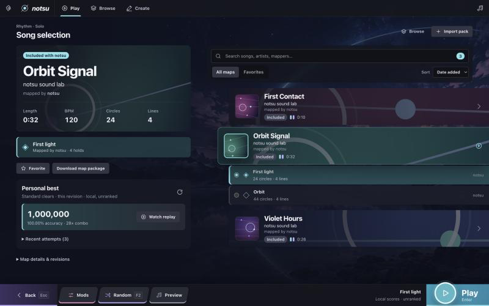
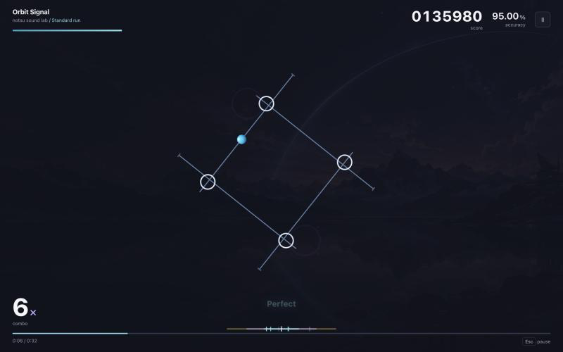
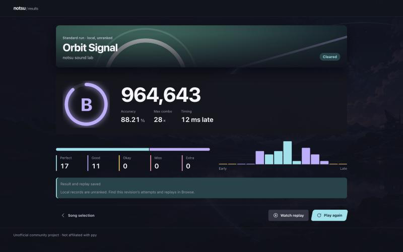

# notsu

An original rhythm game built around moving lines and timed circles. Lines
translate, rotate and stretch to the music; circles ride them into a target, and
any key hits them. notsu runs in desktop browsers and as a Tauri desktop app for
Windows, macOS and Linux.

notsu is an unofficial community project. It is not affiliated with or endorsed by ppy.



## Features

- **Play.** Three starter packs with original music, two difficulties each. Taps,
  holds and shared hits, health, combo and accuracy. Practice mods (No Fail,
  Autoplay), pause with a count-in, and local records with replays.
- **Create.** A map editor with MP3/WAV import, a waveform and beat grid, line
  choreography, autosave and recovery, undo/redo, and engine playtests. Maps
  export as `.notsumap` packs that include the song.
- **Make it yours.** Skin packs, volume, tap-along timing calibration, reduced
  motion, and keyboard or controller navigation.
- **Online (optional).** Accounts, map publishing, friends, private messages and
  moderation through Supabase and a Cloudflare Worker. Without configuration the
  game is fully offline and hides every online entry point.

| | |
| --- | --- |
|  |  |

## Run

Requires Node.js 22.12+ and npm. The desktop app also needs Rust and the
[Tauri prerequisites](https://v2.tauri.app/start/prerequisites/) for your OS.

```sh
npm ci
npm run dev          # browser game at the printed local URL
npm run tauri dev    # desktop app
```

Leave the three `VITE_*` variables in `.env.example` empty for an offline build.
To use online services locally, see [online setup](docs/online.md).

## Test and build

```sh
npm test                      # unit and component tests (Vitest)
npm run build                 # type check and production web build
npm run api:check             # type check the Worker API
npm run test:db               # database policy tests (local Supabase)
npm run test:online           # live integration tests (local Supabase + Worker)
npm run tauri build           # desktop bundles for the current OS
```

Release steps, what has been verified and what still needs an owner are in the
[release checklist](docs/RELEASE_CHECKLIST.md).

## How it plays

- Press any letter, number, punctuation key, Space or controller face button as a
  circle reaches its target. Circles that arrive together are one press.
- Hold ribbons: press the solid head and release at the hollow end with the same key.
- Misses and extra presses break combo and cost health. Score is 70% combo
  continuity and 30% accuracy. Judgement windows are ±45 / ±90 / ±140 ms.
- The Web Audio clock is the source of truth; frame rate never affects judgement.

Full rules are in [gameplay](docs/rhythm.md) and the
[public-beta contract](docs/public-beta.md).

## Project layout

```text
src/
  app/          Composition, routes, global styles, controller input
  features/     One folder per feature: components/, domain/ (pure rules), data/ (adapters)
    rhythm/     Engine, HUD, results, settings and calibration
    maps/       Library, song selection, packages, publishing
    editor/     Map authoring
    skins/      Skin packs
    accounts/, friends/, messages/, presence/, moderation/, records/, home/, trivia/
  shared/       Design tokens, base styles and the component library
server/         Hono API for Cloudflare Workers
supabase/       Migrations and pgTAP policy tests
src-tauri/      Minimal Rust desktop host (bounded native save dialogs)
docs/           Setup, design direction, feature notes and release checklist
```

Starter music and cover art are generated by the project
([starter maps](docs/starter-maps.md)); no third-party media is included.
